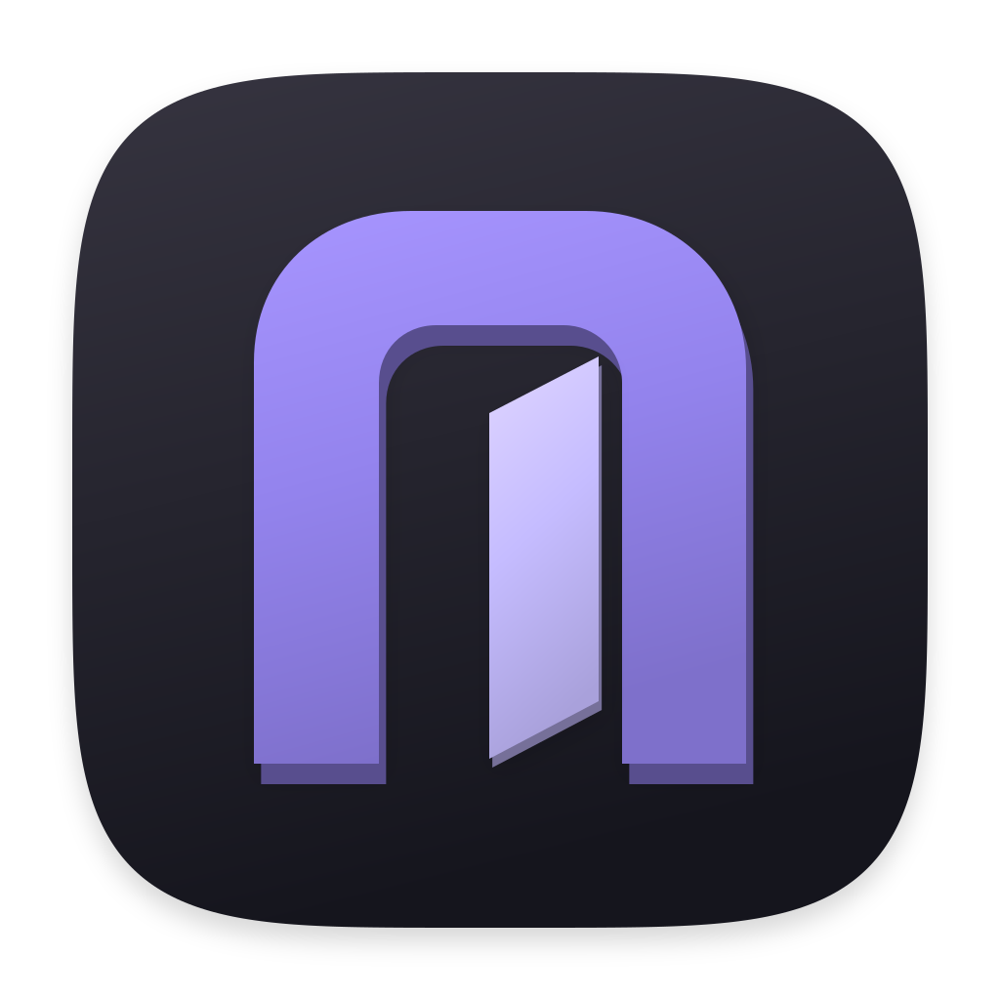
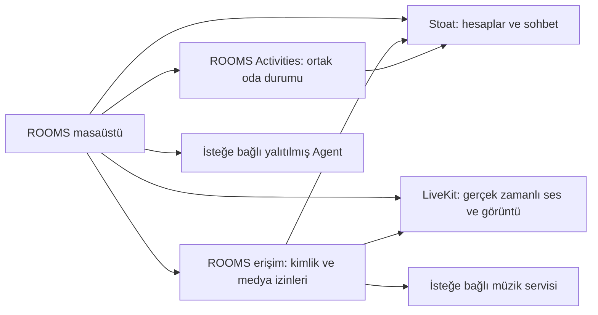

<div align="center">

# ROOMS



### Arkadaşlarınla buluş. Sunucun sende kalsın.

[](https://github.com/egemenmermer/rooms/releases/latest)
[](LICENSE)
[](https://github.com/egemenmermer/rooms/releases/download/v0.1.18-rc.14/ROOMS-0.1.18-rc.14-arm64.dmg)
[](https://github.com/egemenmermer/rooms/releases/download/v0.1.18-rc.14/ROOMS-0.1.18-rc.14-windows-x64-setup.exe)

Sesli sohbet, ekran paylaşımı, mesajlar, müzik ve ortak etkinlikler — tek masaüstü uygulamasında.

[Başlangıç](#başlangıç) · [Ekran görüntüleri](#uygulamadan-görüntüler) · [Kendi sunucunu kur](docs/SELF_HOSTING.md) · [Belgeler](#belgeler)

**Kendi sunucunda çalışır · Açık kaynak · MIT lisanslı**

</div>


## İçindekiler

- [ROOMS nedir?](#rooms-nedir)
- [Başlangıç](#başlangıç)
- [İndir ve topluluğa katıl](#i̇ndir-ve-topluluğa-katıl)
- [Uygulamadan görüntüler](#uygulamadan-görüntüler)
- [Neler yapabilirsin?](#neler-yapabilirsin)
- [Kaynak koddan çalıştır](#kaynak-koddan-çalıştır)
- [Kendi topluluğunu kur](#kendi-topluluğunu-kur)
- [Nasıl çalışıyor?](#nasıl-çalışıyor)
- [Platformlar ve projenin durumu](#platformlar-ve-projenin-durumu)
- [Gizlilik ve özelleştirme](#gizlilik-ve-özelleştirme)
- [Belgeler](#belgeler)
- [Katkıda bulunma](#katkıda-bulunma)
- [Lisans](#lisans)

## ROOMS nedir?

ROOMS, küçük bir topluluğun masaüstündeki buluşma yeridir. Ses odasında konuşabilir, ekranını paylaşabilir, mesajlaşabilir ve uygulamadan çıkmadan arkadaşlarınla birlikte vakit geçirebilirsin.

**Sunucuyu sen seçersin.** ROOMS, herkesin tek bir merkezî hesapla girdiği veya herkese açık oda dizini sunan bir hizmet değildir. Topluluk yöneticisi arka ucu kendi sunucusunda çalıştırır, davetleri yönetir ve üyelerle sunucu adresini paylaşır. Hesabın o sunucuya aittir. Kaynak kodda hazır bir kişisel sunucu adresi veya ortak hesap bulunmaz.

İstemci Electron, React ve TypeScript kullanır. Hesaplar ve sohbet için değiştirilmeden, ayrı çalıştırılan **Stoat** arka ucu; gerçek zamanlı ses ve görüntü için **LiveKit** kullanılır. ROOMS servisleri bu sistemleri birbirine bağlar ve ortak etkinlikleri yönetir.

## Başlangıç

| İstediğin | Başlangıç noktası | Gerekenler |
| --- | --- | --- |
| Var olan topluluğa katılmak | [Kullanım rehberi](docs/USER_GUIDE.md) | Uyumlu uygulama, sunucu adresi ve davet veya mevcut hesap |
| Kendi topluluğunu kurmak | [Sunucu kurulum rehberi](docs/SELF_HOSTING.md) | Sunucu, Docker Compose, Node.js ve ağ/TLS/arka uç yönetimi |
| Uygulamayı geliştirmek | [Geliştirme rehberi](docs/DEVELOPMENT.md) | Git, Node.js, pnpm ve kaynak kod |
| Topluluğun DJ görselini değiştirmek | [Özelleştirme rehberi](docs/CUSTOMIZATION.md) | Kendi sunucunun herkese açık görsel dosyalarını yönetebilmek |

**Herkesin sunucu kurması gerekiyor mu?** Hayır. Bir yönetici topluluğun sunucusunu kurar; diğer üyeler masaüstü uygulamasını açıp o sunucuya bağlanır.

## İndir ve topluluğa katıl

Güncel paketler [GitHub sürümleri](https://github.com/egemenmermer/rooms/releases/latest) sayfasındadır. Son yayımlanan arkadaş test sürümü **RC12**:

| Platform | Paket | Durum |
| --- | --- | --- |
| macOS 14+ / Apple Silicon | [RC14 DMG indir](https://github.com/egemenmermer/rooms/releases/download/v0.1.18-rc.14/ROOMS-0.1.18-rc.14-arm64.dmg) | Apple imzalı ve noter onaylı |
| Windows x64 | [RC14 EXE indir](https://github.com/egemenmermer/rooms/releases/download/v0.1.18-rc.14/ROOMS-0.1.18-rc.14-windows-x64-setup.exe) | İmzasız arkadaş test paketi; sistem uyarısı gösterebilir |

1. Platformuna uygun paketi indirip uygulamayı kur.
2. Topluluk yöneticisinden sunucu adresini ve gerekiyorsa davetini al.
3. Uygulamayı açıp o sunucuyu seç; mevcut hesabınla giriş yap veya davetle kayıt ol.
4. Bir sohbet ya da ses odasına gir. Mikrofon, kamera ve ekran izinlerini ilgili özelliği kullanırken ver.

Uygulamayı indirmek bir sunucuya üyelik veya hazır hesap sağlamaz. Aynı uygulamayı kullanan farklı toplulukların hesapları ve verileri ayrıdır. Etiketlenmiş kaynak kod arşivi de kurulum paketi değildir.

Mac güncellemeleri yapılandırılmış Sparkle kanalından sunulur. Windows'ta yeni EXE indirilip kurulur. Sürüme özgü sınırlamalar ve gerçek cihaz kabul durumu için [sürüm notlarını](https://github.com/egemenmermer/rooms/releases/latest) oku. Kaynaktan derlemek istersen [aşağıdaki adımları](#kaynak-koddan-çalıştır) izle.

## Uygulamadan görüntüler

### Topluluk ana sayfası

Konuşmalarını, kişileri ve odaları aynı yerden aç.


### Sohbet

Topluluğunla mesajlaş; odadaki etkinliklere konuşmanın içinden ulaş.


### Ses odaları

Bir odaya katıl, konuş ve medya kontrollerine ulaş.


Bu görüntüler, uygulamanın gerçek arayüzünden örnek topluluk verileriyle alınmıştır. Canlı görüşme kaydı veya her isteğe bağlı entegrasyonun yapılandırıldığına dair kanıt değildir. Etiketler ve ekran düzeni sürümler arasında değişebilir.

## Neler yapabilirsin?

| Alan | Ne işe yarar? | Gereken altyapı |
| --- | --- | --- |
| Topluluk ve sohbet | Hesap, kanal, mesaj, arkadaşlık, profil ve rol yönetimi | Uyumlu Stoat kurulumu ve kanal/rol izinleri |
| Ses ve ekran paylaşımı | Konuşma, kamera ve seçilen ekran/pencere yayını | LiveKit, erişim servisi, açık medya portları ve işletim sistemi izinleri |
| İzinli uzaktan kontrol | Yayıncının onayıyla fare ve klavye kontrolü | Yerel giriş bileşeni, oturum yetkisi ve platform izinleri; gerçek cihaz kabulü ayrıca gerekir |
| Ortak etkinlikler | Paylaşılan araçlar ve sunucunun yönettiği oyun durumu | Activities servisi ve kalıcı depolama |
| Müzik | Topluluk DJ'i, kuyruk ve ortak listeler | İsteğe bağlı müzik servisi, desteklenen kaynaklar ve yönetici yapılandırması |
| Kişisel medya | Sana ait yapılandırılmış medya bağlantıları | Desteklenen sağlayıcı/kaynak ve kendi yetkili erişimin |
| Sunucu yönetimi | Yetkili kişinin sunucu durumu ve yönetim işlerini izlemesi | HostOps kurulumu ve ayrı yönetici yetkileri |
| Agent | İsteğe bağlı görevler, ilerleme ve sonuçlar | Yalıtılmış Agent kurulumu, model bağlantısı ve açıkça verilmiş yetkiler |

Bir ekranın görünmesi o servisi veya sağlayıcı hesabını kendiliğinden kurmaz. Önce temel sohbet ve sesi çalıştır; isteğe bağlı servisleri daha sonra ekle. Sağlayıcı kısıtları ve platform farkları geçerlidir.

## Kaynak koddan çalıştır

**Git**, **Node.js 22.22.0** ve **pnpm 11.25.0** kur. Mac'te yerel bileşenler için Xcode Command Line Tools da gerekebilir. Platform ayrıntıları [geliştirme rehberindedir](docs/DEVELOPMENT.md).

```sh
git clone https://github.com/egemenmermer/rooms.git
cd rooms
pnpm install --frozen-lockfile
```

macOS/Linux kabuğunda:

```sh
ROOMS_PROFILE=dev-contributor pnpm dev
```

Windows PowerShell'de:

```powershell
$env:ROOMS_PROFILE = 'dev-contributor'
pnpm dev
```

Uygulama ayrı geliştirme profiliyle açılır. Topluluğunun adresini gir veya davetini aç. **İstemciyi başlatmak arka ucu başlatmaz.** Çalışan bir topluluk olmadan uygulamayı açabilirsin; gerçek sohbet ve ses akışlarını tamamlayamazsın.

Derleme, doğrulama ve paket komutları için [geliştirme rehberine](docs/DEVELOPMENT.md) bak. Tarayıcıdaki `pnpm dev:web`, arayüz çalışmaları içindir; yerel masaüstü özelliklerini sağlamaz.

## Kendi topluluğunu kur

Kendi sunucunda çalıştırmak, yalnızca masaüstü dosyalarını web'den sunmak değildir:

1. İzole bir sunucu ve kalıcı depolama hazırla.
2. Hesaplar, sohbet ve dosyalar için sabitlenmiş Stoat arka ucunu yapılandır.
3. Yetkili ses/medya için ROOMS erişim servisini ve LiveKit'i çalıştır.
4. Ortak etkinlik ve oyun istiyorsan Activities servisini çalıştır.
5. İlk hesabı ve topluluğu oluştur; ardından davetleri üret.
6. Uzaktaki üyeler için HTTPS/WSS ve medya erişimini yapılandır.
7. Başkalarını davet etmeden önce iki cihazla dene ve bir yedeğin geri yüklenebildiğini doğrula.

[Sunucu rehberi](docs/SELF_HOSTING.md), dosyaları, komutları, portları, yapılandırmayı ve kabul kontrollerini anlatır. Mevcut kaynakta kurulum yardımcıları vardır; **tek komutla eksiksiz üretim kurulumu** yoktur. İlk hesap ve dış ağ yapılandırması hâlâ yöneticinin tamamlaması gereken işlerdir.

## Nasıl çalışıyor?



Yerel kimlik bilgilerini, ekran yakalamayı ve yetkili işlemleri Electron yönetir. Arayüz, tipli bir köprü kullanır. Ses durumu sayfalardan bağımsızdır; uygulama içinde başka yere geçmek görüşmeyi sonlandırmak için tasarlanmamıştır. Sınırlar ve veri sahipliği için [mimari rehberini](docs/ARCHITECTURE.md) oku.

## Platformlar ve projenin durumu

ROOMS aktif geliştirme aşamasındadır; güncel sürüm bir yayın adayıdır. Kaynağın açık olması, tamamlanmış bir herkese açık V1 olduğu anlamına gelmez.

- **macOS 14+ / Apple Silicon:** paketleme yapılandırılmıştır. Güvenilir dağıtım için imza ve Apple noter onayı gerekir.
- **Windows x64:** EXE kurulumu vardır. İmzasız arkadaş test paketi ile güvenilir imzalı yayın farklıdır.
- **Linux:** paketli masaüstü yayın hedefi olarak sunulmaz; sunucu bileşenleri için kullanılır.
- **iPhone:** ayrı eşlikçi projesi ve dağıtımı vardır. Bu deponun masaüstü paketi telefona kurulum sağlamaz.
- **Otomatik güncelleme:** dağıtıcının uyumlu imzalı paketi ve güncelleme beslemesi gerekir. Kaynak koddan alınan derleme kendiliğinden proje sahibinin kanalına katılmaz.
- **İsteğe bağlı entegrasyonlar:** kendi yapılandırmalarını ve kabul kontrollerini gerektirir. Kaynak testleri ve galeri, gerçek cihaz veya sağlayıcı uyumluluğunu kanıtlamaz.

Dağıtımdan önce [sürüm rehberini](docs/RELEASING.md) ve [sorun gidermeyi](docs/TROUBLESHOOTING.md) oku.

## Gizlilik ve özelleştirme

Topluluk yöneticisi kendi kurulumunu ve verisini yönetir. Kendi sunucunda çalıştırmak uçtan uca şifreleme anlamına gelmez: medya aktarım sırasında şifrelenir; E2EE yapılandırılmış değildir. Saklama, silme, yedekleme ve destek politikalarını yönetici belirlemelidir.

Açık istemcide özgün bir statik DJ çizimi bulunur. Her topluluk kendi adını, posterini ve isteğe bağlı animasyonunu kaynak kodu değiştirmeden sunabilir. [Özelleştirme rehberine](docs/CUSTOMIZATION.md) bak. Kişisel sağlayıcı kimlik bilgileri ve özel operasyon dosyaları Git'e konmaz.

## Belgeler

[Tüm belgeler ve okuma sırası](docs/README.md) · [RC12 yayın ve doğrulama kaydı](docs/RC12_RELEASE.md)

| Rehber | İçeriği |
| --- | --- |
| [Kullanım](docs/USER_GUIDE.md) | Katılım, hesap, sohbet, ses, ekran paylaşımı ve günlük kullanım |
| [Sunucu kurulumu](docs/SELF_HOSTING.md) | Servisler, yerel kurulum, dış ağ, veriler, yedek ve doğrulama |
| [Geliştirme](docs/DEVELOPMENT.md) | Araç zinciri, komutlar, kaynak düzeni ve doğrulama seviyeleri |
| [Mimari](docs/ARCHITECTURE.md) | Süreçler, güven sınırları, depolama ve genişletme noktaları |
| [Sorun giderme ve sık sorulanlar](docs/TROUBLESHOOTING.md) | Kurulum, bağlantı, medya ve güncelleme sorunları |
| [Topluluk rolleri](docs/COMMUNITY_ROLES.md) | Özel roller, renkler, izinler ve yetki sınırları |
| [Uzaktan kontrol](docs/REMOTE_CONTROL.md) | İstek/onay akışı, yerel giriş ve kabul sınırları |
| [Sunucu yönetimi](docs/SERVER_OPERATIONS.md) | İzleme, terminal, HostOps ve operatör yetkileri |
| [Özelleştirme](docs/CUSTOMIZATION.md) | Topluluğa özel DJ görseli ve adı |
| [Sürüm yayımlama](docs/RELEASING.md) | Geliştirme paketleri, imza, güncelleme beslemesi ve yayın kontrolleri |
| [Arka uç entegrasyonu](infra/stoat/README.md) | Bağdaştırıcı, kayıt ve üst sistem kabul notları |
| [Medya aktarımı](docs/MEDIA_TRANSPORT.md) | Tasarım ve geçmiş doğrulama kayıtları |
| [Agent kurulumu](docs/AGENT_DEPLOYMENT.md) | İsteğe bağlı izole Agent altyapısı |
| [Varlık kaydı](docs/ASSETS.md) | Görsellerin ve yazı tiplerinin kaynağı |
| [Üçüncü taraf bildirimleri](docs/THIRD_PARTY_NOTICES.md) | Bağımlılık ve üst sistem lisansları |

## Katkıda bulunma

Issue ve odaklı PR'lara açığız. Çalışma ortamları arasındaki sözleşmeleri değiştirmeden önce [CONTRIBUTING.md](CONTRIBUTING.md) belgesini oku. Hata bildirimine yeniden üretim adımlarını ve ilgili platform/sürüm bilgisini ekle; parola, özel mesaj, davet kodu ve kişisel medya adreslerini ekleme.

Güvenlik açıklarında herkese açık issue yerine [SECURITY.md](SECURITY.md) yolunu izle.

## Lisans

Özgün ROOMS kodu ve uygun özgün varlıklar [MIT lisanslıdır](LICENSE). Bağımlılıklar, yazı tipleri ve ayrı arka uç servisleri kendi lisanslarını korur. ROOMS'un MIT lisansı Stoat'ı veya üçüncü taraf medyayı yeniden lisanslamaz. Üçüncü taraf lisanslarının özgün metinleri dağıtımlarda korunur.
