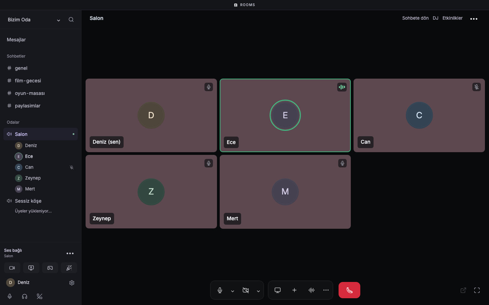
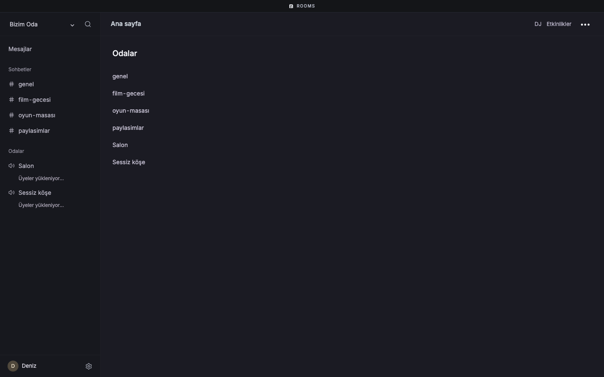
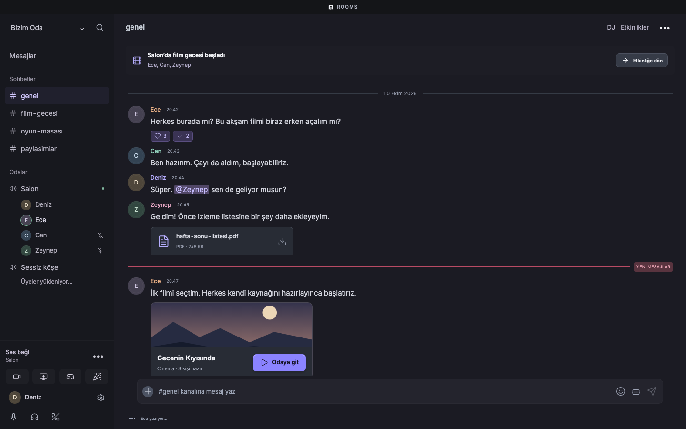
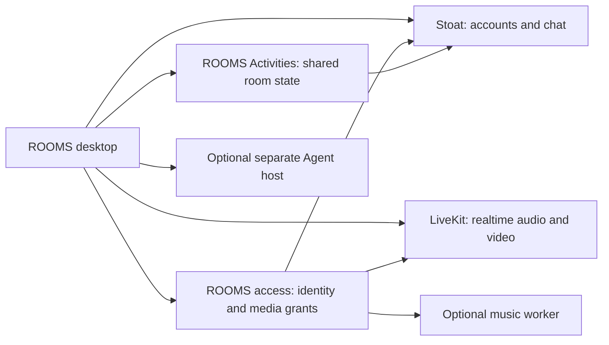

<div align="center">

# ROOMS

### A place to hang out. A server you control.

Voice, chat, screen sharing, music, and shared activities — together in a desktop app.

[Getting started](#getting-started) · [Screenshots](#a-look-inside) · [Self-hosting](docs/SELF_HOSTING.md) · [Documentation](#documentation)

**Self-hosted · Open source · MIT licensed**

</div>



## Contents

- [What is ROOMS?](#what-is-rooms)
- [Getting started](#getting-started)
- [A look inside](#a-look-inside)
- [What you can do](#what-you-can-do)
- [Run the desktop app from source](#run-the-desktop-app-from-source)
- [Host your own community](#host-your-own-community)
- [How it works](#how-it-works)
- [Platforms and project status](#platforms-and-project-status)
- [Privacy and customization](#privacy-and-customization)
- [Documentation](#documentation)
- [Contributing](#contributing)
- [License](#license)

## What is ROOMS?

ROOMS is a desktop clubhouse for a small community: talk in a voice room, share your screen, send messages, and spend time together without leaving the app.

**You choose the server.** ROOMS is not a centrally hosted service with a universal account or a public room directory. A community operator runs the backend, manages invitations, and supplies the server address. Your account belongs to that server. The source distribution has no built-in maintainer server or shared credentials.

The client uses Electron, React, and TypeScript. An unmodified, separately self-hosted **Stoat** backend handles social accounts and chat; **LiveKit** carries realtime audio and video. ROOMS services connect those systems and manage shared activities.

## Getting started

| I want to… | Start here | What I need |
| --- | --- | --- |
| Join an existing community | [User guide](docs/USER_GUIDE.md) | A compatible desktop build, the operator's server address, and an invitation or existing account |
| Run my own community | [Self-hosting guide](docs/SELF_HOSTING.md) | A server, Docker Compose, Node.js, networking/TLS setup, and administration of the backend |
| Build or contribute | [Development guide](docs/DEVELOPMENT.md) | Git, Node.js, pnpm, and a local checkout |
| Change the community DJ artwork | [Customization guide](docs/CUSTOMIZATION.md) | Control of your community's public branding assets |

**Where do I download it?** Ask your community operator for their compatible installer and invitation. This repository currently publishes source; it does not offer a maintained public installer download. A tag alone is not an installer. You can [build the client yourself](#run-the-desktop-app-from-source).

**Do all my friends need a server?** No. One operator hosts the community; everyone else runs the desktop client and connects to that server.

## A look inside

### Community home

Find your conversations, people, and shared spaces in one place.



### Chat

Keep a conversation alongside the rest of your community.



### Voice rooms

Open a voice room to talk and access its media controls.


These images are captured from the actual application interface with sample community data. They show the interface, not a record of a live call or a guarantee that every optional integration is configured. The current interface includes Turkish labels.

## What you can do

| Area | What it is for | What it depends on |
| --- | --- | --- |
| Community and chat | Accounts, channels, messages, relationships, and profiles | A compatible Stoat deployment and your channel permissions |
| Voice and screen sharing | Talk and share a selected screen or window | LiveKit, the access service, reachable media ports, and OS permissions |
| Shared activities | Room activities and games with server-owned state | The Activities service and persistent storage |
| Music | A community DJ and shared queue | Optional music worker, supported sources, and operator configuration |
| Personal media | Your own configured media connections | A supported provider/source and your own authorized access |
| Agent | Optional delegated tasks and results | A separately configured Agent host and explicit grants |

An interface entry does not automatically provision a backend or a provider account. Start with chat and voice; add optional services after the core works. Provider restrictions and platform differences still apply.

## Run the desktop app from source

Install **Git**, **Node.js 22.22.0**, and **pnpm 11.25.0**. On macOS, native components may also require the Xcode Command Line Tools. See [development](docs/DEVELOPMENT.md) for platform details.

```sh
git clone https://github.com/egemenmermer/rooms.git
cd rooms
pnpm install --frozen-lockfile
```

On macOS/Linux shells:

```sh
ROOMS_PROFILE=dev-contributor pnpm dev
```

On Windows PowerShell:

```powershell
$env:ROOMS_PROFILE = 'dev-contributor'
pnpm dev
```

The app opens with a separate development profile. Enter your community's server address or open its invitation. **Starting the client does not start the backend.** Without a running community, you can open the app but cannot complete real chat or voice journeys.

For build, verification, and packaging commands, see [development](docs/DEVELOPMENT.md). Browser-only `pnpm dev:web` is useful for layout work but does not provide the native desktop features.

## Host your own community

Self-hosting means operating several services, not just serving the desktop files:

1. Prepare an isolated server and persistent storage.
2. Configure the pinned Stoat backend for accounts, chat, and uploads.
3. Run the ROOMS access service and LiveKit for authorized voice/media.
4. Run Activities if you want shared activities and games.
5. Bootstrap the first account/community, then issue invitations.
6. Configure HTTPS/WSS and media reachability for remote clients.
7. Test with two devices and verify a backup restore before inviting others.

The [self-hosting guide](docs/SELF_HOSTING.md) explains the files, commands, ports, configuration, and acceptance checklist. The current repository provides setup helpers, **not a one-command production installer**. First-account provisioning and public deployment still require operator work; the guide calls out those boundaries explicitly.

## How it works



Electron owns native credentials, capture, and privileged operations. The renderer uses a typed bridge. Voice state lives outside individual pages, so navigating the interface does not intentionally end the call. Read the [architecture guide](docs/ARCHITECTURE.md) for boundaries and data ownership.

## Platforms and project status

ROOMS is in active development; the current package version is a release candidate. Open source availability is not a claim of a finished public V1.

- **macOS 14+ / Apple Silicon:** packaging is configured. Trusted distribution requires signing and notarization.
- **Windows x64:** installer packaging is configured. Unsigned development installers are separate from a trusted release.
- **Linux:** not an advertised packaged desktop release target. Linux is used for server components.
- **Automatic updates:** require the distributor's own compatible signed release and update feed. A source build is not automatically enrolled in the maintainer's feed.
- **Optional integrations:** need their own configuration and acceptance. Source tests and gallery images do not establish real-device or upstream-provider compatibility.

See [releasing](docs/RELEASING.md) and [troubleshooting](docs/TROUBLESHOOTING.md) before distributing a build.

## Privacy and customization

Community operators control their deployment and data. Self-hosting does not imply end-to-end encryption: media uses encrypted transport, and E2EE is not configured. Operators must set their own retention, deletion, backup, and support policies.

The public client includes an original static DJ illustration. Each community can supply its own name, poster, and optional animation without changing the app source. See [customization](docs/CUSTOMIZATION.md). Personal provider credentials and private operator files do not belong in Git.

## Documentation

| Guide | What you will find |
| --- | --- |
| [User guide](docs/USER_GUIDE.md) | Joining, accounts, chat, voice, screen sharing, and everyday use |
| [Self-hosting](docs/SELF_HOSTING.md) | Services, local setup, public deployment, data, backups, and validation |
| [Development](docs/DEVELOPMENT.md) | Toolchain, commands, source layout, and verification levels |
| [Architecture](docs/ARCHITECTURE.md) | Processes, trust boundaries, storage, and extension points |
| [Troubleshooting and FAQ](docs/TROUBLESHOOTING.md) | Common setup, connection, media, and update problems |
| [Customization](docs/CUSTOMIZATION.md) | Per-community DJ artwork and naming |
| [Releasing](docs/RELEASING.md) | Development builds, signing, update feeds, and release checks |
| [Stoat integration](infra/stoat/README.md) | Detailed adapter, registration, and upstream acceptance notes |
| [Media transport](docs/MEDIA_TRANSPORT.md) | Media design and historical verification notes |
| [Agent deployment](docs/AGENT_DEPLOYMENT.md) | Optional isolated Agent infrastructure |
| [Asset provenance](docs/ASSETS.md) | Source of bundled artwork and fonts |
| [Third-party notices](docs/THIRD_PARTY_NOTICES.md) | Dependency and upstream licensing |

## Contributing

Issues and focused pull requests are welcome. Read [CONTRIBUTING.md](CONTRIBUTING.md) before changing cross-runtime contracts. Include steps to reproduce a bug and the relevant platform/build, but leave credentials, private messages, invite codes, and personal media URLs out of reports.

For vulnerabilities, follow [SECURITY.md](SECURITY.md) instead of posting sensitive details in a public issue.

## License

Original ROOMS code and eligible original assets are [MIT licensed](LICENSE). Dependencies, fonts, and separate backend services retain their own licenses. In particular, MIT licensing of ROOMS does not relicense Stoat or third-party media.
