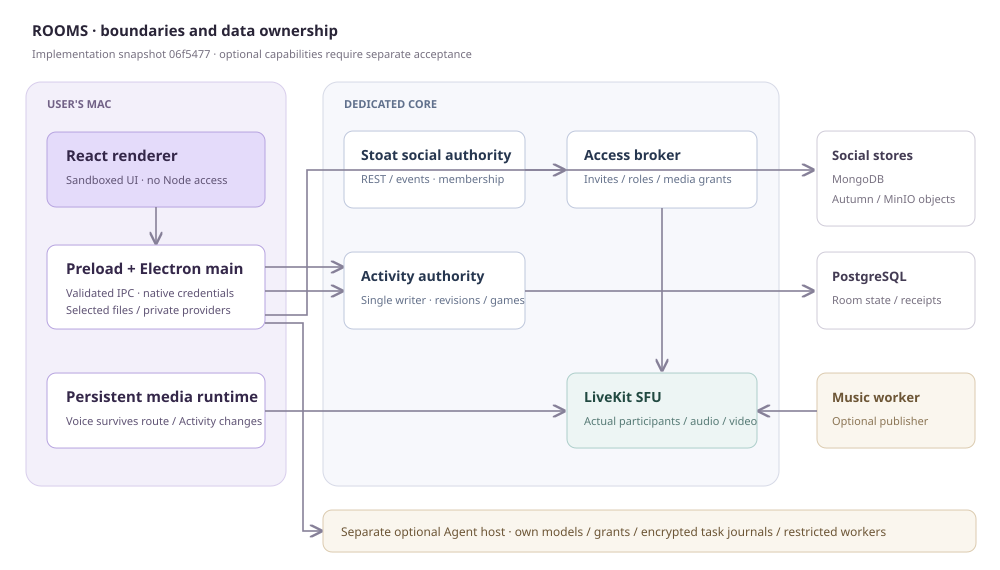
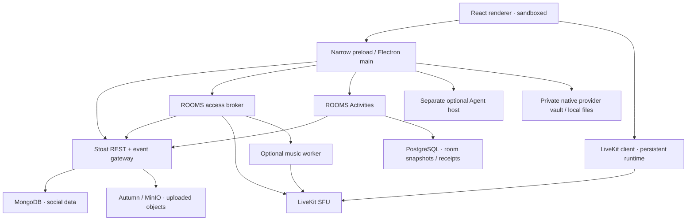

# Architecture and system boundaries
ROOMS separates user interaction, social authority, realtime transport, shared state and optional remote execution. This keeps a screen transition from owning a call, and avoids rebuilding the social backend.

## Logical topology

## Desktop boundary
The renderer renders the application and keeps transient UI state. Electron main owns privileged I/O, persistent sessions, provider requests, source selection, exports, notifications and updates. Preload exposes typed, narrow calls rather than arbitrary filesystem/network/process access.
BrowserWindow enables context isolation and sandboxing, disables Node integration and validates trusted main-frame IPC. The renderer receives opaque capabilities/metadata for selected files rather than raw disk paths or persistent provider credentials.
Zustand owns application, community and realtime state; React Query manages selected server snapshots. Screen components are lazy-loaded where appropriate. A root error boundary offers reload after a rendering failure.

## Social authority
The active adapter targets pinned, unmodified Stoat. It translates upstream identities, messages, relationships, channels, permissions and gateway events into provider-neutral contracts.
Stoat owns social persistence and membership. The access broker does not invent a separate truth for account/channel permission. A narrowly scoped Mongo reader can read channel/server/member context for permission calculation; the user identity still comes from the authenticated social server.
Spacebar code is historical material, not the active native social provider.

## Access and media authority
The access service authorizes voice joins, source permissions, presenter reservations, direct calls and music-control requests. It issues short-lived LiveKit JWT grants and validates signed media webhooks. Current membership/permissions are rechecked; denied/revoked participants are removed.
LiveKit owns realtime transport, tracks and participant observations. It is not the account or community database. Client media lifetime is independent of routes and Activity lifecycle. Device consent and a selected-source capability precede publication.

## Shared Activity authority
A single authoritative service serializes commands for each room. Revisions, command receipts, leases and user-specific projections prevent duplicate writes and private-hand disclosure. PostgreSQL stores room state; local file/memory repositories support development/tests.
PostgreSQL durability does not make multiple independent writers safe. Horizontal Activity clustering is not implemented and should not be assumed.

## Optional Agent and personal providers
Agent execution belongs to a separate Linux host with separate encrypted state, grants, model profiles, restricted workers and a controlled browser. It must not mount the core database, desktop filesystem or personal provider vault.
Personal providers run behind native requests and encrypted credentials. The application uses opaque playback handles and bounded public-address fetches; shared Activity state contains safe reference metadata, not private URLs/tokens.

## Current music and update paths
The current DJ is a separate voice publisher, distinct from the older official YouTube player. It owns a bounded volatile queue and uses an authorized access lease. Source/provider availability and public distribution permission remain separate concerns.
Current signed Mac delivery embeds Sparkle. Its native updater verifies signed archives and controls installation; the older electron-updater path is not proof of the current native update journey.

## Deliberate tradeoffs
Unmodified social upstream rather than a fork; one Activity writer rather than speculative clustering; encrypted bounded local caches rather than unlimited history replicas; explicit platform/source support rather than synthetic success; optional Agent separated from the core trust boundary.
These are implementation boundaries. Tests and release acceptance must demonstrate that the boundary holds under failure, not merely on happy-path rendering.
